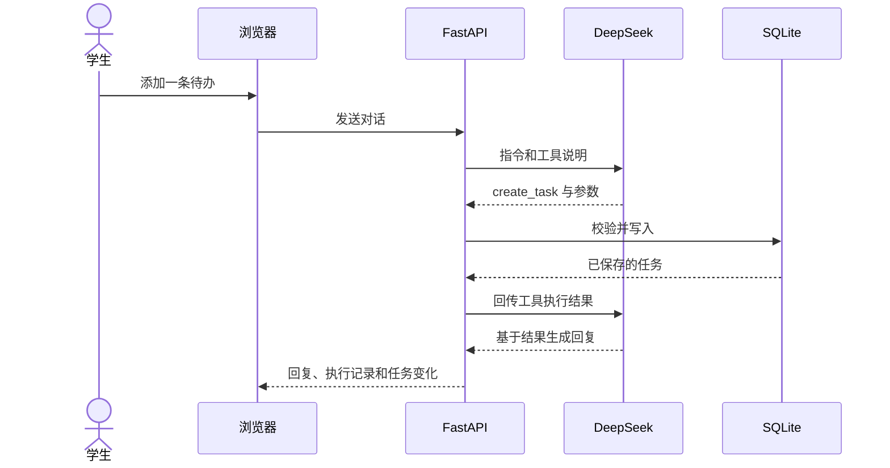

# 课伴 CampusFlow 课堂演示

建议用时 5–7 分钟。启动应用后，在空工作区导入课程演示示例。若要现场演示 AI，请提前在设置页确认密钥已配置，并发送一条实际消息验证模型能返回结果。

## 汇报提纲

| 页 | 内容 | 讲解要点 |
|---|---|---|
| 1 | 校园学习任务管理 | 作业截止日期、学习时段和任务进度需要统一管理 |
| 2 | 课伴的交互 | 浏览器里并排展示任务工作区与 AI 助手，操作结果可在日历验证 |
| 3 | 系统架构 | React 管理界面，FastAPI 负责执行，SQLite 持久化，DeepSeek 选择工具 |
| 4 | 工具调用闭环 | 用户说「帮我新增待办」，模型提出工具和参数，后端校验并写入，模型根据实际结果回复 |
| 5 | 现场演示 | 生成计划草稿、调整并保存、安排时间、标记完成、展开执行记录 |
| 6 | 测试与边界 | 展示日期分离、冲突回滚、撤销和 API 错误处理。结果以实测为准 |

## 现场操作

1. 打开「今日概览」，展示当周安排与完成率，说明任务的截止日期和学习时段可以分别填写。
2. 在 AI 助手发送「下周五要交机器学习读书报告，请帮我拆成四步。每天最多 60 分钟，只生成计划草稿。」使用一个未在示例数据中出现的项目名，便于找到本轮新任务。
3. 点击「查看计划草稿」，检查预计时长和日期，修改一步的标题，再点「保存并加入任务」。切到「项目计划」确认四个步骤已经保存。
4. 选一个项目步骤和空闲时段，发送「把机器学习读书报告的第二步安排到下周三 19:00，截止日期保持原样。」打开周历查看实际安排。如果当前时间或已有任务不适用，改用界面上能看到的空闲日期和时间。
5. 发送「把机器学习读书报告的第一步标记为完成」，或手动点击任务复选按钮，回到项目页核对进度。展开对话中的执行记录，指出任务 ID 和状态如何对应界面。
6. 演示一次撤销或冲突检查。课堂网络不稳定时可继续演示手动任务、日期、周历和项目进度，并展示之前的真实调用记录或录屏。

## 手工验收记录

填写实测结果。对于 AI 指令，同时核对文字回复和真实任务状态。

| 场景 | 输入或操作 | 期望行为 | 实测 |
|---|---|---|---|
| 新建 | 帮我添加一条「阅读第 3 章」待办 | 任务新增一次，无须编造截止日期 | 待填写 |
| 查询 | 今天有哪些未完成任务 | 结果与今日任务一致 | 待填写 |
| 模糊对象 | 创建两个同名任务后说「完成复习」 | 询问具体对象 | 待填写 |
| 计划 | 下周五前完成报告，每天最多 60 分钟，拆为四步 | 草稿可编辑，确认后才新增任务 | 待填写 |
| 排期 | 把第二步改到一个空闲时段 | 安排更新，截止日期保持原样 | 待填写 |
| 冲突 | 安排两个时间重叠的未完成任务 | 页面说明冲突，第二次写入失败 | 待填写 |
| 撤销 | 删除一项任务后点击撤销 | 任务回到列表及日历 | 待填写 |
| 持久化 | 刷新或重启应用 | 已保存任务仍可读取 | 待填写 |
| API 失败 | 使用无效密钥启动后发送消息 | 显示鉴权错误，任务保持原状态 | 待填写 |

展示工具调用时，可以说明语言模型负责理解意图和选工具，后端负责检查数据、执行操作和返回结果。时间重叠等规则由代码判断，课堂评估可以据此区分模型理解和程序执行两类错误。
